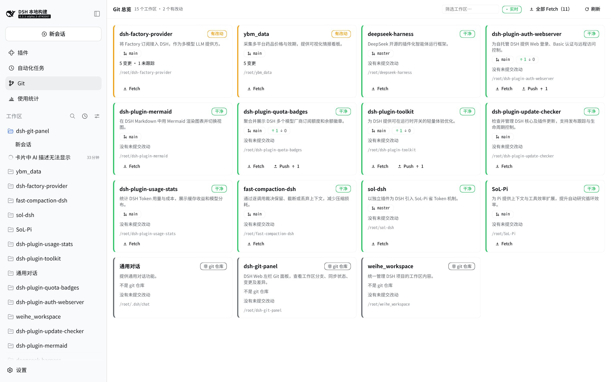
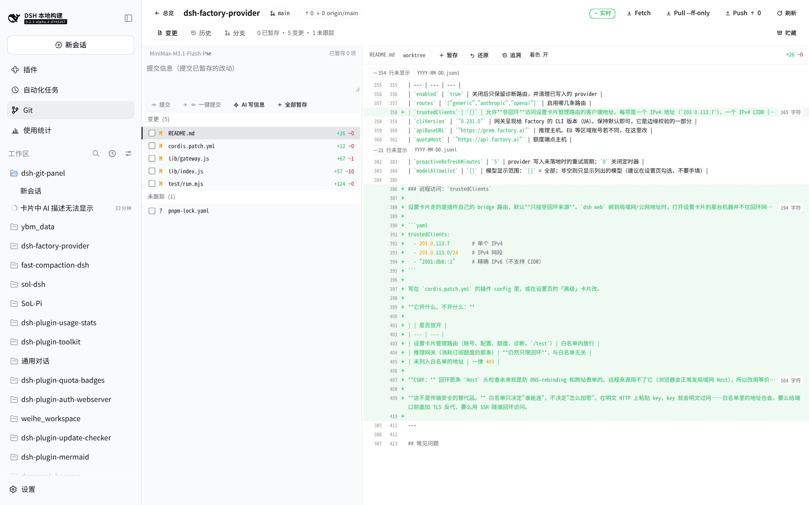
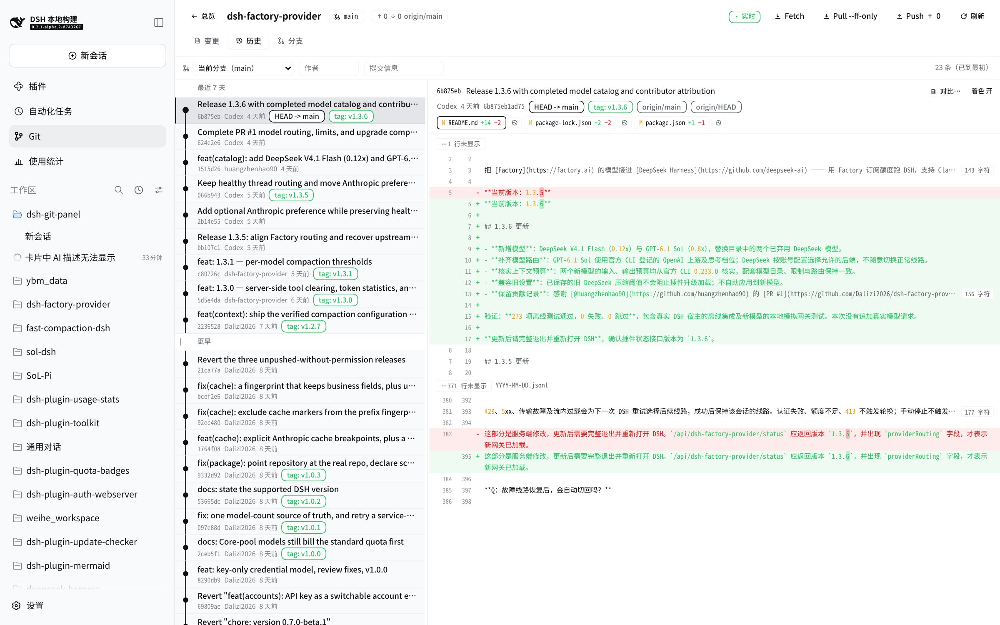
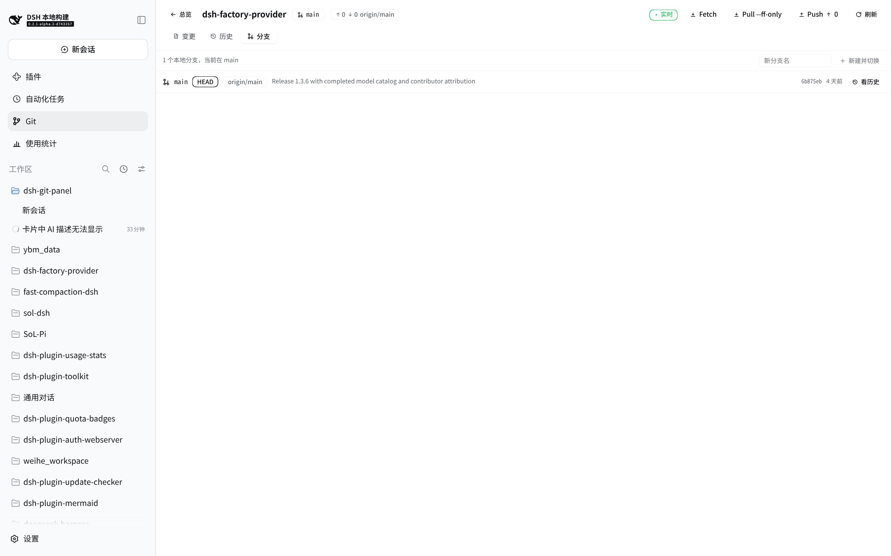

# @dsh-external/dsh-git-panel

[简体中文](README.zh-CN.md) | **English**

[](LICENSE)


A **Git panel for the DSH Web UI**: one Git icon in the left rail, one full-page panel that shows every registered workspace at a glance and gives a single repository three views (changes / history / branches). It never switches branches behind your back, never force-pushes, and never stages anything silently — every destructive action asks you twice.



- **Read paths are read-only.** Every route below `/status`, `/diff`, `/log`, … only runs git commands that cannot write the repository (`GIT_OPTIONAL_LOCKS=0`).
- **Three remote actions** (`fetch --prune`, `pull --ff-only`, `push`) and a small, explicit set of local writes, all behind one guard rail (`POST /action`).
- **Live, not polled.** The panel subscribes to each repository's `.git` over SSE and refreshes the moment a commit, branch switch, fetch or push lands.
- **Agent-friendly.** The read path is also exposed as `ctx.gitPanel` and as three model tools (`git_status`, `git_diff`, `git_commit_message`).

## Table of contents

- [Install](#install)
- [Screens](#screens)
- [Features](#features)
- [Configuration](#configuration)
- [HTTP API](#http-api)
- [Agent surface](#agent-surface)
- [Security model](#security-model)
- [Development](#development)
- [Notable design decisions](#notable-design-decisions)
- [Troubleshooting](#troubleshooting)
- [License](#license)

## Install

The package is a **DSH bundle plugin** (a profile assembly layer). Three ways in:

**① Into a profile (survives restarts)** — register the package and its config in the profile's `cordis.patch.yml`:

```yaml
- id: git-panel
  name: '@dsh-external/dsh-git-panel'
  config:
    aiCommitProvider: minimax-cn
    aiCommitModel: MiniMax-M3.1-Flash-Preview
    aiCommitReasoningEffort: low
```

Then make the package part of `dsh.profile.bundles` (or `npm i` it into the profile directory). The plugin ships its own `cordis.patch.yml`, which inserts the loader row — **that row can only come from the bundle's own patch file**, and without it the routes and the rail icon disappear on the next profile re-assembly or restart (see [Notable design decisions](#notable-design-decisions)).

**② Live injection (handiest while developing)** — no restart, no profile edit:

```
dev_install_package { "dir": "/path/to/dsh-git-panel" }   # first install
dev_reload_package  { "packageName": "dsh-git-panel" }    # after changing host code
```

`dev_install_package` skips an entry that already exists, so host-code changes need `dev_reload_package` (it clears the loader cache and rebuilds the fiber). Client-only changes need neither: `npm run build:client` and a page refresh.

**③ Build from source** — `scripts/build.sh` links every build dependency (cordis, schemastery, react, `@types/node`, `@deepseek-ai/dsh-tools`, tsdown) straight out of the checkout, so a clean clone needs **no `npm i`**:

```bash
git clone git@github.com:kolawong/dsh-git-panel.git
cd dsh-git-panel
DSH_CHECKOUT=/path/to/deepseek-harness npm run build:all   # host tsc + client bundle
```

> ⚠️ After touching `src/client/**` you **must** run `npm run build:client` (or `build:all`). `scripts/build.sh` only compiles the host and *type-checks* the client — it does not bundle `lib/client.js`, so the type check passes while the browser still loads the previous UI.

Requirements: Node ≥ 20, `git` on `PATH`, and a DSH checkout for `DSH_CHECKOUT` (peer dependencies `cordis`, `schemastery` and `react` are provided by the host).

## Screens

| Overview | Changes + diff |
|---|---|
|  |  |

| History (graph lanes) | Branches |
|---|---|
|  |  |

Regenerate them against a running harness with `node scripts/readme-shots.mjs` (writes `docs/*.jpg`).

## Features

### Overview — the landing screen

One card per registered workspace, dirty ones first:

- A left colour bar states the situation: conflict (red) / has changes (yellow) / clean (green) / not-a-repository or unreadable (grey).
- Each card carries the branch, the upstream and `↑ahead ↓behind`, the change tally (`staged · changed · untracked · conflicted`) and the workspace path.
- **An AI one-liner** — "what is this project?" — written from one model call for all workspaces (see [AI project summaries](#ai-project-summaries)).
- A filter box narrows cards by name or path and reports `N / M workspaces`.
- `全部 Fetch (N)` fetches every repository that has an upstream, one at a time, with per-card progress; `● 实时` / `● 轮询` shows which update mode is live.

### Repository page — changes / history / branches

**Changes**: branch, upstream and ahead/behind; the changed-file list grouped into conflicted / staged / changed / untracked; per-file unified diff; the commit box (with `✨ AI write message`); a `贮藏` (stash) action; and the repository's stash list at the bottom.

**History**: a graph-drawn commit list — every commit is one row with its own lane and merge curves (SVG), ref labels (`HEAD ->`, `tag:`, `origin/*`), author and relative time. Grouped by calendar day (today / yesterday / last 7 days / earlier), with range / author / subject / path filters, infinite "load earlier commits" paging (`HISTORY_PAGE = 50`), and a commit detail pane on the right that reuses the same diff renderer. Merge commits get `compare ^1 / ^2` buttons, because `git show <merge>` prints no patch at all.

**Branches**: local branches, newest tip first, current branch on top with a `HEAD` badge, upstream + `[ahead/behind]`, tip hash/time/subject. `看历史` hands a branch to the history view. Branch switching and `checkout -b` are available and both ask for confirmation.

### Diff rendering

`src/client/diff.ts` parses unified diffs into a line model and the renderer draws them the way the official pages do:

- Two line-number gutters (old / new) plus a sign column; only counted hunk-body lines advance the numbers.
- File headers (`diff --git`, `index`, `---`, `+++`, mode, rename) are **not** rows — the panel title already names the file and shows `+28 −2`.
- Gaps between hunks collapse into a `⋯ 74 lines not shown` chip; clicking it fetches **that range** from the host (`GET /context`, ≤ 400 lines) and splices it back as ordinary context lines.
- Row tints for added/removed lines and intra-line highlighting for rewritten ones (common-prefix/suffix trimming, so `Current` → `Longest` lights up only `Curren` / `Longes`).
- Long lines fold to one ellipsized row, but only after a real width measurement proves they overflow; the `159 chars` chip sits outside the text span so it survives clipping.
- Conservative syntax colouring: only four token classes (comment / string / keyword / number), only quotes closed on the same line, only unambiguous keywords, and `//` or line-leading `#` comments. A toggle in the diff header turns it off completely.
- Combined diffs (`diff --cc`) for conflicted files: two prefix columns per line, result-side line numbers only.

### Write operations

All local writes go through one `POST /action` route with the same guard rails (custom header + JSON, workspace allow-list, one action per repository at a time, argv allow-list, child processes bound to the plugin lifecycle).

| Action | Command | Notes |
|---|---|---|
| `stage` | `git add -- <paths…>` | `全部暂存` passes `paths: ['.']`; paths are mandatory — there is no "no paths means everything" |
| `unstage` | `git reset -q HEAD -- <paths…>` | Falls back to `git rm --cached -r --quiet -- <paths…>` before the first commit |
| `discard` | `git checkout -- <paths…>` | **Destructive, needs `confirm: true`**; discards worktree-vs-index, so staged content survives |
| `stash` | `git stash push --include-untracked --message "dsh-git-panel: <ISO>"` | **Destructive, needs `confirm: true`**; includes untracked files |
| `commit` | `git add -- <paths…>` (optional) → `git commit -m <message>` | Message required (≤ 4000 chars); hooks run normally (never `--no-verify`) |
| `stashApply` / `stashPop` / `stashDrop` | `git stash apply/pop/drop <ref>` | `ref` must be the listed `stash@{N}`; `drop` needs `confirm: true` |
| `continueOperation` / `abortOperation` | `git commit --no-edit` (merge) or `git -c core.editor=true <op> --continue` / `git <op> --abort` | Refuses to continue while conflicts remain; `abort` needs `confirm: true` |
| `checkout` | `git checkout <ref>` / `git checkout -b <name>` | Branch names go through `safeRef`; needs `confirm: true` |

Remote actions: `fetch` (`git fetch --prune`), `pull` (`fetch` then `pull --ff-only`), `push` (`git push`, **needs `confirm: true` or 428**). The argv never contains `--force`, `--tags` or `--set-upstream`. A push is never one click: the button first arms a "confirm push → origin/main" state for 8 seconds.

Everything lands in an in-panel action log at the bottom of the screen: timestamp, each command, exit code, duration and the git output tail.

### Conflicts and in-progress operations

`GET /status` reports `operation: {kind: merge|cherry-pick|revert|rebase, unmerged: N} | null`. When one is running, the changes view grows a banner with two honest ways out (`完成合并` / `继续…` and `中止…`), and conflicted files render as combined diffs. The verbs come from the host, not from a guess: with nothing in progress the panel says so.

### Blame and range compare

- `追溯` runs `git blame --line-porcelain HEAD -- <path>` and shows one label per contiguous attribution run; uncommitted files 404 and untracked files get a disabled button with the reason.
- History detail has `对比…`: arm it, click another commit, and the detail becomes a range read (`git diff <base> <commit>`) with the same renderer. `base` and `parent` are mutually exclusive (400).

### AI commit message

`✨ AI write message` drafts a commit message into the box, streaming token by token (`POST /commit-message/stream`, SSE frames `begin` → `delta` → `done`/`error`). While it streams the button becomes `停止`, which also aborts the model call. The endpoint is a same-origin POST with the panel's custom header, so a stray page cannot spend your tokens.

- **What it reads**: staged changes when there are any (that is exactly what `git commit` records), otherwise the whole work tree — and the UI says so. Untracked files and unstaged changes are listed separately as "will not be part of this commit".
- **Guard rails**: diff line/byte budgets (default 1200 lines / 64 KB, with the truncation stated to both the model and the UI); no tools are passed, so the model can only produce text; the reply is sanitized (code fences, preambles, thinking blocks, wrapping quotes, blank-line squeeze, 4000-char cut) before it reaches the box.
- **Model memory**: the picker remembers the provider/model through the **settings service** — i.e. in the plugin's own profile configuration, live for every browser and visible on the settings page (`POST /prefs`). With no settings service it falls back to `localStorage` and reports `persisted: false`.
- **Priority**: explicit request > remembered pick > profile default model.

### AI project summaries

One model call writes a one-line "what is this project" for **every** workspace on the overview:

- Signals per repository: `package.json` description, the first 400 characters of the README, the last three commit subjects.
- **Per-repository persistence** in `~/.dsh/git-panel/summaries.json` (override with `DSH_GIT_PANEL_SUMMARY_STORE`). The cache key is a sha1 fingerprint of exactly the signals that wrote it — provider, model, title, description, README, commit subjects — so a busy repository costs a rewrite of its own line while quiet ones are answered from disk. The first ask after a reload is already `cached: true`.
- **Settled per project, not per batch**: if the model call fails, the stored summaries are still returned (`error` + `failed: N` alongside them) and only the projects that truly have no line stay empty; a failure with nothing stored at all is an honest 502 (504 on timeout). The panel therefore never blanks the cards it already had — a missing line reads `简介暂不可用` with the reason in its tooltip instead of a shimmer that never ends.
- `force: true` rewrites everything. Workspaces that left the registry are pruned from the store.

### Live updates

The panel **subscribes instead of polling**: opening it starts one SSE stream per visible repository (`GET /events?dir=…`), and the host watches that repository's `.git` (itself + `refs` recursively + `logs` recursively) with `fs.watch`.

- **Filtering**: `objects/`, `*.lock`, `gc.*`, `maintenance`, `COMMIT_EDITMSG`, `tmp_*` are dropped — one fetch writes hundreds of objects, and forwarding those would turn a fetch into a refresh storm.
- **Debounce**: 300 ms per repository, so `.git/HEAD` and `refs/heads/x` changing together produce one refresh.
- **Degradation**: when the stream cannot start (disabled, inotify exhausted, unsupported backend) the panel falls back to 15 s / 20 s polling; with a stream open, polling stretches to 60 s as a safety net. The header chip `● 实时` / `● 轮询` says which mode is active (`data-live` for automation).
- **Worktree edits are out of scope**: `fs.watch` cannot see an unstaged edit (it touches neither the index nor refs), and watching whole trees recursively would cost node_modules-scale overhead. Polling and window-focus refresh cover that case.

## Configuration

| Field | Default | Purpose |
|---|---|---|
| `timeoutMs` | `20000` | Deadline for one read-only git command |
| `actionTimeoutMs` | `60000` | Deadline for one fetch/pull/push |
| `outputMaxBytes` | `4194304` | stdout cap for one git command |
| `actionOutputMaxBytes` | `32768` | Bytes of each stream an action hands back |
| `contextLines` | `3` | Unified-diff context lines |
| `overviewConcurrency` | `4` | Workspaces inspected at once |
| `allowPush` | `true` | `false` refuses `push` (403); fetch/pull still work |
| `allowRepoWrites` | `true` | `false` refuses stage/unstage/discard/stash/commit (403) |
| `watchEnabled` | `true` | `false` makes `/events` answer 503 and the panel poll |
| `fetchBeforePull` | `true` | Refresh remote refs with `fetch --prune` before fast-forwarding |
| `aiCommitEnabled` | `true` | Master switch for both AI features |
| `aiCommitProvider` / `aiCommitModel` | empty | Model used by the panel; empty follows the profile default selection |
| `aiCommitReasoningEffort` | empty | Reasoning effort (`low`/`medium`/`high`/`max`…). **Empty omits the option entirely** — it is *not* `off`; see [Troubleshooting](#troubleshooting) |
| `aiCommitLanguage` | `zh` | Language of drafts and summaries |
| `aiCommitMaxDiffLines` / `aiCommitMaxDiffBytes` | `1200` / `65536` | How much diff one draft may read |
| `aiCommitTimeoutMs` | `60000` | Deadline for one model call |
| `aiCommitExtraPrompt` | empty | Extra instruction appended to the draft's system prompt |

`aiCommitProvider`, `aiCommitModel` and `aiCommitReasoningEffort` are **volatile**: the settings service can rewrite them live (that is how the picker remembers a model across browsers).

## HTTP API

All routes live under `/api/git-panel`. `dir` is always validated against the workspace registry **before** any git command runs (403 otherwise).

| Route | Purpose |
|---|---|
| `GET /overview` | One card's data per registered workspace (two git commands per repository, `overviewConcurrency` at a time; an unreadable workspace degrades to an "unavailable" card) |
| `GET /status?dir=` | Branch/upstream/ahead-behind + file list + line counts + `operation` |
| `GET /diff?dir=&path=&staged=&untracked=&hash=&parent=&base=` | One file's unified diff (worktree, index, a commit, a merge parent, or a range) |
| `GET /context?dir=&path=&staged=&untracked=&hash=&start=&count=` | Unchanged lines for expanding a diff gap (`start ≥ 1`, `1 ≤ count ≤ 400`; `missing` / `binary` flags) |
| `GET /log?dir=&limit=&skip=&all=&ref=&path=&author=&grep=` | Commit history, newest first, `--topo-order`; `limit` 1..200, `skip` 0..100000 |
| `GET /branches?dir=` | Local branches (newest tip first, current first) with upstream/track/date/subject |
| `GET /show?dir=&hash=&parent=&base=` | One commit's metadata and touched files |
| `GET /stashes?dir=` | Stash list (newest first) |
| `GET /blame?dir=&path=` | Per-line attribution (`git blame --line-porcelain HEAD`) |
| `GET /models` | Provider routes and their advertised models (5-minute host cache) + `remembered` |
| `GET /events?dir=…&dir=…` | SSE: a `hello` frame describing what is watched, then one debounced `change` frame per repository; comment-only heartbeats when idle (≤ 64 dirs) |
| `POST /action` | `{dir, action, confirm?, paths?, message?, ref?}` — every remote and local write |
| `POST /commit-message` | `{dir, staged?, provider?, model?, reasoningEffort?}` — one draft (read-only: it never touches the index) |
| `POST /commit-message/stream` | The same draft as SSE frames |
| `POST /prefs` | `{provider?, model?}` — remember the draft model via the settings service |
| `POST /project-summaries` | `{force?, provider?, model?, reasoningEffort?}` — the one-line project summaries |

Write routes require `content-type: application/json` and the `x-dsh-git-panel` header (a cross-origin form cannot set it). Read routes time out with 504; actions time out with 504 **without** being killed by the browser disconnecting (they are bound to the plugin lifecycle, not the request). One action per repository at a time (409).

## Agent surface

Other plugins can inject the read path as a service:

```ts
interface GitPanelService {
  overview(): Promise<{ ok: true; entries: OverviewEntry[] }>
  status(dir: string, lineCounts?: boolean): Promise<StatusPayload>
  diff(dir: string, target: { path: string; staged?: boolean; untracked?: boolean; hash?: string }): Promise<string>
  log(dir: string, limit?: number): Promise<CommitEntry[]>
  show(dir: string, hash: string): Promise<{ commit: CommitEntry | null; files: CommitFile[] }>
}
```

**The service is read-only on purpose**: write operations are deliberately not exposed, because there is no human finger behind a service call and those operations destroy uncommitted work. Every `dir` still goes through the workspace allow-list.

Three model tools are registered (through `ctx.inject(['tools'])`, so a profile without a tools service still loads the panel):

| Tool | Arguments | Notes |
|---|---|---|
| `git_status` | `dir?` (default: all workspaces), `line_counts?` | Without `dir`: branch/upstream/ahead-behind/counts per workspace. With `dir`: `repo` + `counts` + the file list |
| `git_diff` | `dir`, `path`, `staged?`, `untracked?`, `hash?`, `max_lines?` | Unified diff lines, truncated to 400 by default (1..2000) with explicit `total_lines` / `truncated` / `note` |
| `git_commit_message` | `dir`, `staged?`, `provider?`, `model?` | Text only — it never stages, commits or pushes, and says what one model call costs |

## Security model

- **Workspace allow-list first**: every client-supplied `dir` is checked against `workspaceRegistry.list()` before any git command runs (403 outside it). Paths may not be absolute and may not contain `..` (400).
- **argv, never a shell**: git is spawned through the host subprocess service with an argv array, a scrubbed non-interactive environment (`GIT_TERMINAL_PROMPT=0`, `GIT_CONFIG_COUNT=0`, `GIT_OPTIONAL_LOCKS=0`, `LC_ALL=C`), a per-command deadline and a bounded stdout cap.
- **A non-zero exit is a result, not an exception** — only transport failures (timeout, abort) throw.
- **Writes are explicit**: exactly the actions in the table above, one at a time per repository, destructive ones behind `confirm: true`, and `allowRepoWrites` / `allowPush` can switch whole groups off.
- **Read paths never write the repository** (`GIT_OPTIONAL_LOCKS=0` also stops the panel from writing `.git/index` and triggering its own watcher).

## Development

```bash
npm run build:all                                           # scripts/build.sh + npm run build:client
DSH_CHECKOUT=/path/to/deepseek-harness bash scripts/build.sh # host tsc + client type check only
npm run build:client                                        # tsdown → lib/client.js

node scripts/smoke.mjs        # host smoke: real git, real routes           (328 assertions)
node scripts/diff-test.mjs    # client pure logic on real git diff output   (115 assertions)
node scripts/live-check.mjs   # against a running harness, real requests    (112 assertions)
node scripts/visual-check.mjs # real Chromium end-to-end + screenshots      (141 assertions)
node scripts/rail-check.mjs   # "is the Git icon there and does it open?"   (4 assertions)
node scripts/readme-shots.mjs # regenerate docs/*.jpg for this README
```

`visual-check.mjs`, `rail-check.mjs` and `readme-shots.mjs` resolve Playwright and its chromium from the harness checkout and `~/.cache/ms-playwright`; if either is missing they print SKIP and exit 0 so they never break a plain test run. They read the profile's login credentials only to drive the login form — nothing is printed or written to disk.

| File | Responsibility |
|---|---|
| `src/index.ts` | Host half: the `/api/git-panel/*` routes, SSE, `fs.watch`, `ctx.subprocess`, path/ref/parent validation, the write guard rails, the AI calls and the summary store |
| `src/client/index.ts` | Client half: two slot registrations (`main` + `sidebar.panellist`) |
| `src/client/panel.tsx` | The page: overview / repository (changes · history · branches), commit box and model picker, diff rendering |
| `src/client/styles.ts` | Injected design system (one `<style>` element, removed on unload) — hover/focus/transitions that inline styles cannot express |
| `src/client/icons.tsx` | The whole 16×16 line-art icon set (no emoji, no font glyphs) |
| `src/client/diff.ts` | Pure logic: unified diff → line model, intra-line diff, rewrite pairing |
| `src/client/graph.ts` | Pure logic: commit list → lane layout (`buildGraph` / `graphWidth`) |
| `src/client/highlight.ts` | Pure logic: conservative tokenizer + intra-line marker overlay |
| `src/client/queue.ts` | Pure logic: sequential execution with progress reporting |
| `src/client/api.ts` | The JSON contract with the host and the fetch helpers |
| `cordis.patch.yml` | The bundle patch that inserts the loader row |

## Notable design decisions

- **The bundle patch is not optional.** A profile boots by stacking patch layers, and a bundle contributes loader rows **only** through its own `cordis.patch.yml` (declared as `dsh.bundle.patch`). This package once shipped without it: runtime injection made everything look fine until the profile was re-assembled, at which point host routes 404'd and the rail icon vanished while `dsh.profile.bundles` still listed the package. `smoke.mjs` now guards that contract with four assertions, and `rail-check.mjs` answers "is the icon there?" in seconds with a real browser.
- **The client is a separate bundle.** `lib/client.js` is produced by tsdown, not by `tsc`, which is why `scripts/build.sh` cannot cover it.
- **No hardcoded colours.** The client references only theme tokens measured to exist in this runtime; `color-mix` derives the rest, and the visual suite asserts that no literal colour creeps back in.
- **One action per repository.** A `409` is cheaper than two `git add`s racing each other.
- **`pull` is `--ff-only`.** The panel refuses to invent merge commits; if the branch diverged, git's own refusal is shown verbatim.
- **Bare `<button>` needs `background: transparent`.** The UA's buttonface paints a grey block over rows — that is what "the whole file list looks selected in dark mode" was.
- **The list column uses the shell's sidebar fill token** (`--dsw-specific-sidebar-fill`) and a `border-l2` separator — `border-l1` is too faint to read as a boundary.

## Troubleshooting

**Cards show `简介暂不可用` / the AI one-liner never appears.**
The summary route reports why: `POST /api/git-panel/project-summaries` answers `error` + `failed: N` when the batch call failed, and the stored lines still come back. The usual cause is the model call itself being rejected — for example MiniMax's `MiniMax-M3.1-Flash-Preview` now requires adaptive thinking and returns `400 … requires adaptive thinking (2013)` when the request disables thinking. Two fixes:

```yaml
# Option A — tell this plugin's calls to think:
aiCommitReasoningEffort: low
```
```yaml
# Option B (deeper, also fixes the agent's own calls to that route) — under the
# llm-pi-ai provider config, drop the `off` declaration so no request ever sends
# thinking.type=disabled for that model:
- id: llm-pi-ai
  config:
    providers:
      minimax-cn:
        models:
          - id: MiniMax-M3.1-Flash-Preview
            reasoningEfforts: { low: low, medium: medium, high: high, max: max }
```

Note the asymmetry that makes this easy to get wrong: **an empty `aiCommitReasoningEffort` omits the option** (the model/route decides), while the literal `off` *requests* that thinking be disabled — and some routes refuse that outright.

**The icon and the routes disappeared after a restart.** The bundle patch row is missing (see above) — check that `cordis.patch.yml` is present and that `package.json` still declares `dsh.bundle.patch`.

**`TS7006: Parameter 'args' implicitly has an 'any' type` when building from a fresh clone.** The build could not resolve `@deepseek-ai/dsh-tools`, so `defineTool`'s callbacks lost their contextual types. `scripts/build.sh` links that package (and every other build dependency) from `DSH_CHECKOUT`; make sure `DSH_CHECKOUT` points at a built DSH checkout.

**The panel shows the old UI after a client change.** `lib/client.js` was not rebuilt: run `npm run build:client` and refresh.

**The panel fell back to `● 轮询`.** `/events` could not start (watching disabled, inotify limits, unsupported backend) — the panel keeps working at 15 s / 20 s polling; see the host logs for the reason.

## License

BSD-3-Clause — see [LICENSE](LICENSE).
